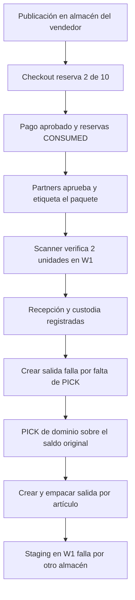

# R0.F2A · Del inventario del vendedor al retiro por el comprador

Repositorio `Alelandtrkz/ecuvel`. Revisión del 25 de noviembre de 2026, hora de Ecuador.

## A. Preflight y recuperación

En `E:\ecuvel`, la rama `master`, el HEAD local, `origin/master` y la referencia consultada en GitHub coincidieron en `210eb3c0fc8d0e7a52bd4a499a1e002a151f252e`, `fix(security): enforce account and store identity isolation`. El árbol estaba limpio al iniciar. Al reanudar, conservaba los cambios locales y tres archivos nuevos de implementación, migración y pruebas. Se conservaron tanto el índice como los cambios de trabajo.

La conexión de prueba devolvió `current_database() = ecuvel_test` en PostgreSQL 17.10. `compose.test.yaml` usa `db_test`, con los datos en tmpfs. La comprobación de nombre real de la base también forma parte del arranque de pytest. El head inicial era `a9b0c1d2e3f4`. Al reanudar, la tabla de Alembic de la base aislada ya contenía `b47e912cf630`.

## B–D. Reproducción, recorrido anterior y diagnóstico

Antes de editar los servicios, se ejecutó `test_published_sale_reproduces_disconnected_pick_and_staging` sobre la implementación del baseline. Pasó comprobando **los dos rechazos esperados**. La prueba se convirtió después en la regresión positiva `test_published_sale_from_seller_stock_to_customer_in_one_point`. Usó un borrador con imágenes, la publicación moderada, el carrito persistido, el checkout, la presentación y aprobación del comprobante y la aprobación del vendedor. La publicación creó el saldo en el almacén de la tienda. W1 era el único punto de la red.



`product_publication` usa `ensure_store_inventory_location()` e inicializa el saldo de la oferta. El checkout selecciona el almacén con disponibilidad para esa oferta y reserva contra sus balances. En el baseline, la recepción actualizaba la entrada y el seguimiento, pero dejaba el saldo en 10 físicas y 2 reservadas. Se invocó el servicio real de picking para aislar el segundo defecto. La creación produjo una salida por artículo y el empaque funcionó. El staging rechazó la ubicación ECUVEL porque `_get_order_item_warehouse_id()` resolvía el origen comercial. La web carecía de una acción que conectara recepción, picking, salida y staging. Había comandos de demostración para los tres últimos pasos.

El otro dato faltante era el destino final. Los textos globales presentados al comprador carecían de una referencia estable al almacén. El destino de un traslado puede representar una escala y el punto activo de un empleado identifica dónde trabaja.

## E–H. Diseño, momento de consumo y trazabilidad

| Responsabilidad | Identidad y evidencia | Operación que la establece |
|---|---|---|
| Stock comercial | Oferta, tienda, ubicación, `InventoryBalance` | Publicación y movimientos de inventario |
| Unidades comprometidas | `InventoryReservation.order_item_id`, `balance_id`, cantidad | Checkout crea la reserva. El pago aprobado la pasa a `CONSUMED` |
| Entrada del vendedor | `SellerInboundPackage.seller_order_id` y PK compuesta `(package_id, order_item_id)` con cantidad | Partners asigna cantidades y marca el paquete listo |
| Custodia física | Recepción con actor, hora y ubicación. Estado único por entrada, traslados y eventos históricos | Escaneo exacto en ECUVEL y operaciones de traslado |
| Salida para el comprador | `OrderPackage.order_item_id` único, cantidad completa, código y ubicación de retiro | Admin confirma empaque y staging en el destino registrado |
| Entrega | Identidad del comprador del pedido, códigos exactos, operador y hora en todos los paquetes | Scanner confirma la entrega completa en una transacción |

**Consumo financiero y retirada física.** El contrato existente consume la reserva al aprobar la transferencia. En ese instante el balance todavía conserva las unidades comprometidas. El `PICK` reduce conjuntamente `on_hand_quantity` y `reserved_quantity` cuando Scanner ha recibido todas las unidades del artículo. Para una reserva indivisible repartida entre cajas, la primera recepción parcial deja evidencia física de su contenido y mantiene las unidades comprometidas. La última completa el picking de la línea. Esta decisión conserva la cardinalidad de los movimientos y evita retirar unidades aún pendientes de comprobación.

La clave `pick:<UUID de la reserva en hexadecimal>` y la referencia `INVENTORY_RESERVATION` identifican cada retirada. Se verifica el balance, las cantidades y la identidad de un PICK previo. El replay conserva su movimiento original. La recepción nunca crea stock vendible de ECUVEL. La entrega tampoco escribe movimientos de stock.

La relación entre entrada y salida se reconstruye por claves foráneas a través del mismo `OrderItem`. Se suman las asignaciones recibidas del subpedido y se comprueba la custodia de **cada** entrada. El SKU sirve para cotejar el contenido escaneado. El enlace histórico usa los identificadores de línea y paquete. Un traslado nuevo queda bloqueado cuando su contenido ya se empacó para el comprador. Las entradas cuyo contenido completo ya está preparado se excluyen del conteo físico de entradas para evitar contar también su embalaje anterior.

## I–K. Un punto, varios puntos y varias tiendas

- **Un punto.** Checkout fija W1. El operador recibe la entrada, abre el pedido en Admin, confirma el empaque en una ubicación activa de tipo `PICKUP_STAGING`, imprime la etiqueta de salida y entrega mediante Scanner. La prueba verifica el POST de recepción, el formulario de preparación, la etiqueta imprimible y el POST de entrega. El flujo usa un único punto de red, sin traslado ni transportista.
- **Varios puntos.** W1 recibe. La asignación conserva la custodia del origen y la recogida la transfiere al transportista. Si este llega a W3 por error, W3 registra `INCIDENT_REPORTED`. El paquete sigue `IN_TRANSIT`, con el mismo transportista, traslado y destino W2. La recepción posterior en W2 habilita la preparación cuando también se reúnen las demás unidades.
- **Escala autorizada.** Otra prueba recibe legítimamente en una escala cuyo identificador difiere del punto final. La custodia local permite recibir el traslado. La preparación para el comprador exige continuar hasta el punto registrado en el pedido. También se comprueba el bloqueo de contenido en cuarentena.
- **Multivendedor.** Dos tiendas publican por separado y preparan sus propios subpedidos. Una línea de dos unidades se reparte entre dos entradas recibidas en distintos puntos. Admin prepara el pedido cuando la suma exacta de todas las líneas se reúne en W2. La identidad, el punto y el conjunto completo de códigos se vuelven a validar al entregar. Una caja faltante, duplicada o ajena invalida la operación.
- **Rechazo de una tienda.** El rechazo existente libera las cantidades conforme al contrato del vendedor y conserva su indicación de resolución financiera. Las otras tiendas mantienen sus subpedidos. Como la entrega sigue exigiendo todas las líneas originales, el resto no se ofrece al comprador como entrega parcial. La resolución comercial de ese pedido queda en el flujo de excepción existente.

## L. Estados utilizados

| Entidad | Transiciones y alcance |
|---|---|
| `Order` | `PENDING_PAYMENT → CONFIRMED` al aprobar el comprobante. Se admiten también `FULFILLING` y `READY_FOR_PICKUP` para operar. La disponibilidad real se deriva de todas las salidas. Los estados globales `CANCELLATION_REQUESTED`, `CANCELLED`, `EXPIRED` y `COMPLETED` excluyen nuevas preparaciones. La entrega sigue el contrato histórico de paquetes y subpedidos. |
| `SellerOrder` | Pago confirmado abre decisión `PENDING → APPROVED` o `REJECTED`. El rechazo conduce a `CANCELLED`. `CONFIRMED`, `PICKING`, `PACKED` y `READY_FOR_PICKUP` son estados operativos existentes. La evidencia de entrega completa sincroniza `COMPLETED`, `delivered_at` y `payout_eligible_at`. |
| `InventoryReservation` | `ACTIVE → CONSUMED` con pago. Las salidas de cancelación y expiración conservan `RELEASED` y `EXPIRED`. Un PICK válido registra el retiro sobre una reserva consumida. |
| `SellerInboundPackage` | `CREATED → READY_FOR_DROPOFF → RECEIVED_BY_ECUVEL`. `CANCELLED` fue probado como entrada histórica terminal. La interfaz examinada permite crear, imprimir y marcar listo. |
| `LogisticsPackageState` | `AT_POINT → ASSIGNED → IN_TRANSIT → AT_POINT`. Un intento de llegada errónea agrega un evento. `DEVIATED` conserva el tratamiento correctivo histórico. La entrega completa cambia el estado a `DELIVERED` y registra al comprador como custodio. |
| `LogisticsTransfer` | `ASSIGNED → IN_TRANSIT → RECEIVED`. La incidencia conserva `IN_TRANSIT`. Se preservan los estados históricos `DEVIATED` y `CANCELLED`. |
| `OrderPackage` | `CREATED → PACKED → READY_FOR_PICKUP → HANDED_OVER`. `CANCELLED` impide staging y entrega. Un paquete corresponde a una sola línea y contiene su cantidad íntegra. |

## M. Acciones disponibles

| Actor y superficie | Acciones comprobadas |
|---|---|
| Partners web | Consultar el subpedido autorizado, aprobar o rechazar, crear una entrada con el remanente, imprimir/reimprimir etiqueta y marcar lista para Drop-off. |
| Dominio de Partners | Asignaciones parciales explícitas para varias cajas, con UUID de solicitud para distinguir dos cajas idénticas de un reintento de la misma. La UI actual agrupa el remanente. |
| Admin Scanner | Seleccionar punto habilitado, verificar entrada por contenido y cantidades, confirmar recogida, llegada válida o incidencia, identificar al comprador y escanear todas las salidas. |
| Admin Fulfillment / Pedidos | Consultar custodia y eventos, asignar/reasignar transporte y abrir el pedido. En **Paquetes del pedido**, confirmar empaque y ubicación de retiro e imprimir etiquetas Code 128 de salida. |
| Dominio / CLI | Persisten los servicios individuales de consumo, PICK, creación, empaque, staging y entrega. Los comandos `*-demo-*` siguen siendo utilidades de demostración. La entrega por esa vía también requiere el código del comprador. |

## N–O. Concurrencia, rollback e inventario observado

Las operaciones relacionadas se serializan sobre el pedido o el subpedido. La preparación y entrega bloquean subpedidos y artículos en orden estable. El picking bloquea primero el vendedor del artículo y después la reserva y el balance. La preparación bloquea los estados físicos, que también usan las operaciones de traslado. Los puntos y ubicaciones que se validan pueden compartir bloqueo de lectura. La selección del destino de checkout y su persistencia forman parte de la misma transacción que carrito, pedido, intento de pago y reservas.

Las carreras de recepción, preparación y entrega usan dos operadores, una barrera y conexiones PostgreSQL con PID distintos. Se exige un resultado nuevo y un replay, una retirada y una entrega completa. Se inyectaron fallos después de consumir una reserva financiera, registrar la custodia, aplicar el PICK, empacar y preparar la salida. Se comprobaron los valores persistidos y, en las operaciones físicas, la repetición posterior. Los savepoints de recepción y preparación protegen incluso al llamador que captura la excepción y confirma su transacción exterior.

| Hito de la compra de 2 | Físicas en el saldo comercial | Reservadas en el balance | Disponibles | Evidencia física |
|---|---:|---:|---:|---|
| Publicación | 10 | 0 | 10 | Saldo del vendedor |
| Checkout | 10 | 2 | 8 | Reserva activa |
| Pago aprobado y caja lista | 10 | 2 | 8 | Reserva consumida. Custodia pendiente |
| Primera unidad si la línea está dividida | 10 | 2 | 8 | Una unidad recibida en su entrada |
| Recepción completa | 8 | 0 | 8 | Un PICK por reserva y dos unidades trazadas |
| Preparación, entrega y reintento | 8 | 0 | 8 | Mismos movimientos y balance de origen |

## P. Cobertura y regresiones

| Matriz | Evidencia principal |
|---|---|
| I01–I07 | Publicación real, reserva y pago de 2, saldo de tienda, PICK preexistente y rollback de consumo, custodia y picking. |
| R01–R08 | Scanner y cadena comercial. Unión exacta de SKU y unidades, cantidades insuficientes/excesivas, paquete creado o cancelado, operador fuera de su punto, replay y confirmación concurrente. |
| P01–P07 | Ausencia de entrada pese a PICK, línea dividida, estados en tránsito, cuarentena, ubicación incorrecta, estado físico y staging válido. Fallos de empaque y staging dejan cero salidas parciales. |
| L01–L05 | Un punto de red, W1–W2, incidencia W3, transporte original y escala intermedia legítima. |
| M01–M05 | Dos tiendas, asignación ajena rechazada, recepciones independientes, pedido incompleto y entrega íntegra con trazabilidad por línea. |
| E01–E08 | Identidad, códigos y punto, ausencia de duplicados, pago original, importes históricos, fecha de entrega y elegibilidad de liquidación. El proceso no crea una liquidación automáticamente. |

**Las dos regresiones del checkpoint.**

1. `tests/test_checkout_service.py::test_concurrent_checkout_cannot_oversell_inventory`. El hilo de prueba abría una sesión SQL sin el contexto Flask que contenía el código de retiro de prueba. Ambos trabajadores salían antes de disputar la unidad. Cada trabajador entra ahora en el contexto de la aplicación configurada. Se mantienen las expectativas de un pedido, una reserva y un perdedor por falta de stock.
2. `tests/test_admin_orders.py::test_tabs_and_fulfillment_filters_use_domain_state`. El caso listo construía directamente una salida y no tenía el destino persistido ni la cadena física requerida por el filtro. Su preparación usa ahora pago, aprobación del vendedor, escaneo, PICK, empaque y staging. Se conserva la expectativa del pedido en la pestaña correcta. La prueba comercial independiente parte de publicación real en el almacén del vendedor.

La primera selección amplia registró 352 éxitos y esos dos fallos. Una selección posterior de 60 registró 59 éxitos y un error de importación de `select` en la prueba del panel operativo. Tras corregir la prueba, una selección de 92 terminó con cero fallos. Las cifras de distintas selecciones se solapan.

**Validación posterior a la reanudación en PostgreSQL.** Las tres ejecuciones siguientes terminaron con código 0. Todas usaron `docker compose -f compose.test.yaml run --rm test pytest -q`, selección explícita bajo `tests/` y `--tb=short`. Los conteos corresponden a ejecuciones y se solapan.

- **346 aprobadas.** `test_seller_custody_chain.py`, `test_checkout_service.py`, `test_admin_orders.py`, `test_admin_operations.py`, `test_fulfillment_rollback.py`, `test_fulfillment_concurrency.py`, `test_integrity_invariants.py`, `test_partner_orders.py`, `test_admin_scanner.py`, `test_scanner_arrival_custody.py`, `test_admin_rbac.py`, `test_admin_inventory.py`, `test_inventory_counts.py`, `test_seller_payouts.py`, `test_admin_payouts.py`, `test_customer_orders.py`, `test_storefront_checkout.py`, `test_financial_foundation.py`, `test_admin_payment_decisions.py`, `test_legal_product_integration.py`, `test_cart_migration.py`, `test_catalog_telemetry_migration.py`, `test_offer_preparation_migration.py`, `test_payout_engine_migration.py`, `test_product_media_migration.py`, `test_legal_versioning.py`.
- **260 aprobadas.** `test_seller_custody_chain.py`, `test_checkout_integrity.py`, `test_checkout_service.py`, `test_storefront_checkout.py`, `test_adult_checkout_guards.py`, `test_product_media_resolution.py`, `test_legal_product_integration.py`, `test_fulfillment_concurrency.py`, `test_fulfillment_rollback.py`, `test_admin_operations.py`, `test_admin_orders.py`, `test_admin_scanner.py`, `test_admin_rbac.py`, `test_scanner_arrival_custody.py`, `test_logistics_tracking.py`, `test_partner_orders.py`, `test_inventory_counts.py`, `test_admin_inventory.py`, `test_admin_payments.py`, `test_product_reviews.py`.
- **24 aprobadas.** Verificación final de los cambios del detalle Admin, la identificación del comprador y el otro constructor de `Order`. Se ejecutaron `test_admin_orders.py` y los nodos `test_seller_custody_chain.py::test_demo_order_writer_also_pins_configured_destination`, `test_seller_custody_chain.py::test_published_sale_from_seller_stock_to_customer_in_one_point`, `test_logistics_tracking.py::test_admin_fulfillment_query_and_private_routes`, `test_admin_rbac.py::test_foreign_resources_and_revoked_context`, `test_admin_rbac.py::test_mixed_order_requires_every_line_to_be_related`, `test_admin_rbac.py::test_transport_reads_and_changes_only_personal_transfer`.

Las selecciones anteriores también cubrieron `test_product_publication.py`, `test_inventory_concurrency.py`, `test_inventory_rollback.py`, `test_payment_proofs.py` y `test_identity_isolation.py`. Las tres últimas corridas notificaron respectivamente 84, 6 y 2 avisos de deprecación de `get_engine` en el entorno de Alembic. Las pruebas de comisiones y conciliación verifican los snapshots financieros. La prueba de entrega contrasta `detail.payment.attempt_id` con el intento original, conserva el comprobante, los importes y los movimientos, y verifica que no se creó una liquidación.

## Q. Gates estáticos

| Comando | Resultado |
|---|---|
| `docker compose -f compose.test.yaml run --rm test python -m compileall -q app tests` | Salida 0 |
| `docker compose -f compose.test.yaml run --rm test flask --app wsgi:app db heads` | Salida 0. Único head `b47e912cf630 (head)` |
| `git diff --check` | Salida 0. Git avisó sobre normalización LF/CRLF en Windows |
| JavaScript | Cero archivos JavaScript modificados o nuevos. No se requirió la suite JS |

## R. Migración autorizada y compatibilidad

`b47e912cf630` sucede directamente a `a9b0c1d2e3f4`. Añade únicamente `orders.pickup_warehouse_id`, UUID nullable y FK `fk_orders_pickup_warehouse` a `warehouses.id` con `ON DELETE RESTRICT`. El checkout nuevo exige un código `Warehouse.code` único en `ECUVEL_PICKUP_WAREHOUSE_CODE`, almacén activo y `seller_store_id IS NULL`. El token firmado incluye el destino presentado al comprador. Si cambia antes de confirmar, se requiere revisar la compra. El replay de un checkout confirmado conserva el pedido y el intento originales.

El upgrade conserva los históricos sin destino como NULL. El downgrade elimina el FK y la columna, lo que pierde las asignaciones escritas mientras la revisión estuvo activa. La prueba conserva un pedido y su evidencia, inspecciona la ausencia de la columna tras downgrade y verifica la FK, el NULL y el bloqueo de preparación después del nuevo upgrade. La prueba se realiza únicamente en `ecuvel_test`.

## S. Riesgos y trabajos pendientes del propietario

- Para desplegar hay que aplicar la revisión y configurar el código real del punto. La falta de configuración, un punto inactivo o una bodega del vendedor bloquean compras nuevas. El cambio de esquema necesita un bloqueo de tabla durante el DDL.
- Los pedidos históricos con destino NULL requieren evidencia y resolución operativa antes de prepararlos para retiro. La migración no infiere un destino a partir de textos, reservas, último traslado ni configuración actual.
- En una recepción parcial, el saldo sigue comprometido mientras llega la última parte de la línea. Rechazos, devoluciones y resolución financiera siguen sus políticas existentes. La simulación comercial integral corresponde a R0.F2B.
- Las validaciones web usan el cliente HTTP de Flask y PostgreSQL. La prueba de etiqueta verifica su generación. La impresión física y la lectura con el equipo del punto quedan para la comprobación en sitio.
- El propietario ejecutó la suite global tras la implementación. La sección X recoge el microcorrectivo resultante. La repetición global y el despliegue de la migración en otros entornos quedan pendientes.

## T. Archivos y alcance de los cambios

- **Nuevos.** `backend/app/services/order_custody.py` contiene los criterios comunes de recepción, destino, custodia y conteo. `backend/migrations/versions/b47e912cf630_order_pickup_warehouse.py` contiene la única revisión. `backend/tests/test_seller_custody_chain.py` recorre la venta publicada y cubre fallos, carreras y migración. El cuarto archivo nuevo es este informe.
- **Checkout y presentación del destino.** Configuración de ejemplo, modelo `Order`, checkout y vistas de Storefront y Partners. También se cubrió el constructor de pedidos del comando de reserva demo para que los pedidos que cree reciban el punto configurado.
- **Operaciones.** Recepción y picking, trazabilidad, contexto por punto, preparación, conteo físico, entrega, etiquetas, rutas Admin y detalle de pedido. El botón de entrega exige el pedido completo en el punto activo y el detalle muestra el destino fijado.
- **Regresión.** Las fábricas antiguas de fulfillment pasan por pago y recepción. Las pruebas financieras reutilizan el intento ya aprobado por la preparación. Cinco módulos de migración actualizan la referencia al head. El listado íntegro de rutas figura abajo.

## U. `git diff --stat`

La estadística acumulada al cierre del microcorrectivo recoge los archivos rastreados. Los cuatro archivos nuevos aparecen en el apartado V.

```text
 .env.example                                       |   3 +
 backend/app/blueprints/admin/__init__.py           |  77 +++++--
 backend/app/blueprints/partners/__init__.py        |   4 +-
 backend/app/commands/fulfillment.py                |   7 +
 backend/app/commands/inventory.py                  |   4 +-
 backend/app/config.py                              |   1 +
 backend/app/models/order.py                        |   6 +
 backend/app/services/admin_fulfillment.py          |   8 +-
 backend/app/services/admin_inventory.py            |   2 +
 backend/app/services/admin_operating_context.py    |  15 +-
 backend/app/services/admin_orders.py               |   6 +
 backend/app/services/admin_scanner.py              |   4 +-
 backend/app/services/barcodes.py                   |   7 +
 backend/app/services/checkout.py                   |  39 +++-
 backend/app/services/customer_orders.py            |   5 +-
 backend/app/services/fulfillment.py                | 255 +++++++++++----------
 backend/app/services/inventory.py                  |  22 +-
 backend/app/services/inventory_counts.py           |   2 +
 backend/app/services/logistics_tracking.py         |  12 +-
 backend/app/services/partner_orders.py             |   4 +-
 backend/app/services/seller_inbound_packages.py    | 162 ++++++++-----
 backend/app/storefront.py                          |  15 +-
 backend/app/templates/admin/fulfillment_label.html |   2 +-
 backend/app/templates/admin/order_detail.html      |  14 +-
 backend/tests/conftest.py                          |   1 +
 backend/tests/factories.py                         |  78 +++++--
 backend/tests/test_admin_operations.py             | 154 ++-----------
 backend/tests/test_admin_orders.py                 |   4 +
 backend/tests/test_admin_payouts.py                |  16 +-
 backend/tests/test_admin_scanner.py                |  30 +--
 backend/tests/test_cart_migration.py               |   2 +-
 backend/tests/test_catalog_telemetry_migration.py  |   2 +-
 backend/tests/test_checkout_service.py             |   4 +-
 backend/tests/test_fulfillment_concurrency.py      |   1 +
 backend/tests/test_fulfillment_rollback.py         |   5 +-
 backend/tests/test_integrity_invariants.py         |   3 +-
 backend/tests/test_offer_preparation_migration.py  |   2 +-
 backend/tests/test_partner_orders.py               |   6 +
 backend/tests/test_payout_engine_migration.py      |   2 +-
 backend/tests/test_product_media_migration.py      |   2 +-
 backend/tests/test_review_modal.py                 |   8 +-
 backend/tests/test_scanner_arrival_custody.py      |   1 +
 backend/tests/test_seller_payouts.py               |  20 +-
 43 files changed, 566 insertions(+), 451 deletions(-)
```

## V. `git status --short`

```text
 M .env.example
 M backend/app/blueprints/admin/__init__.py
 M backend/app/blueprints/partners/__init__.py
 M backend/app/commands/fulfillment.py
 M backend/app/commands/inventory.py
 M backend/app/config.py
 M backend/app/models/order.py
 M backend/app/services/admin_fulfillment.py
 M backend/app/services/admin_inventory.py
 M backend/app/services/admin_operating_context.py
 M backend/app/services/admin_orders.py
 M backend/app/services/admin_scanner.py
 M backend/app/services/barcodes.py
 M backend/app/services/checkout.py
 M backend/app/services/customer_orders.py
 M backend/app/services/fulfillment.py
 M backend/app/services/inventory.py
 M backend/app/services/inventory_counts.py
 M backend/app/services/logistics_tracking.py
 M backend/app/services/partner_orders.py
 M backend/app/services/seller_inbound_packages.py
 M backend/app/storefront.py
 M backend/app/templates/admin/fulfillment_label.html
 M backend/app/templates/admin/order_detail.html
 M backend/tests/conftest.py
 M backend/tests/factories.py
 M backend/tests/test_admin_operations.py
 M backend/tests/test_admin_orders.py
 M backend/tests/test_admin_payouts.py
 M backend/tests/test_admin_scanner.py
 M backend/tests/test_cart_migration.py
 M backend/tests/test_catalog_telemetry_migration.py
 M backend/tests/test_checkout_service.py
 M backend/tests/test_fulfillment_concurrency.py
 M backend/tests/test_fulfillment_rollback.py
 M backend/tests/test_integrity_invariants.py
 M backend/tests/test_offer_preparation_migration.py
 M backend/tests/test_partner_orders.py
 M backend/tests/test_payout_engine_migration.py
 M backend/tests/test_product_media_migration.py
 M backend/tests/test_review_modal.py
 M backend/tests/test_scanner_arrival_custody.py
 M backend/tests/test_seller_payouts.py
?? backend/app/services/order_custody.py
?? backend/migrations/versions/b47e912cf630_order_pickup_warehouse.py
?? backend/tests/test_seller_custody_chain.py
?? docs/R0.F2A-informe.md
```

## W. Estado de la entrega inicial

**R0.F2A IMPLEMENTED — PENDING OWNER REVIEW**

Trabajo disponible en el árbol local de `master`. El índice está vacío. No se ejecutó `git add`, `git commit` ni `git push`. La migración se aplicó y revirtió exclusivamente en la base aislada de pruebas, que quedó en el nuevo head. Desarrollo y producción no se modificaron.

## X. Microcorrectivo de las seis regresiones de reseñas

La suite global ejecutada por el propietario después de implementar R0.F2A registró `6 failed, 1887 passed, 132 warnings in 721.69s`. En la reproducción previa al microcorrectivo se ejecutó `docker compose -f compose.test.yaml run --rm test pytest -q tests/test_review_modal.py` sobre `ecuvel_test`. El resultado fue `6 failed, 1 passed, 2 warnings in 13.06s`. Los seis casos fallaron durante la preparación del pedido. PostgreSQL rechazó el segundo INSERT con `psycopg.errors.UniqueViolation` sobre `uq_payment_attempts_one_approved_per_order`, traducido a `sqlalchemy.exc.IntegrityError`. El séptimo caso, que utiliza un pedido pendiente, pasó en ambas ejecuciones.

### Origen del pago y cambio en el fixture

1. En `backend/tests/factories.py`, `create_ready_for_pickup_order()` llama a `create_picked_order()`, que llama a `create_ready_inbound_order()`. Esta última función crea el intento bancario con estado `AWAITING_PROOF` en la línea 358, lo añade a la sesión en la 364 y hace flush. En las líneas 368–369 presenta el comprobante para ese mismo ID y solicita su aprobación.
2. En `backend/app/services/payment_proofs.py`, la presentación pasa el intento a `PROCESSING` en la línea 272. La rama de aprobación de `review_payment_proof()` cambia ese registro a `APPROVED` en la línea 391. La preparación para retiro y la entrega conservan el intento.
3. La línea 73 original de `_delivered_order()` en `backend/tests/test_review_modal.py` llamaba después a `_add_payment_attempt(..., status=PaymentStatus.APPROVED)`. Ese helper local construía un segundo registro para el mismo pedido y hacía flush. Los seis fallos ocurrieron allí, antes de las operaciones de reseña.
4. El microcorrectivo sustituye esa llamada por una consulta que exige exactamente un intento aprobado para el pedido entregado. Cada uno de los seis casos ejecuta la comprobación. Se conserva la otra llamada a `_add_payment_attempt()`, que crea el intento `AWAITING_PROOF` del pedido sin entregar. La búsqueda en el repositorio identificó únicamente esos dos usos del helper antes de la corrección.

### Resultado de los seis casos originales

| Caso en `test_review_modal.py` | Antes | Después |
| --- | --- | --- |
| `test_delivered_order_detail_has_modal_trigger_and_single_dialog` | Falló en el fixture | Pasó |
| `test_existing_review_changes_detail_action_to_pending` | Falló en el fixture | Pasó |
| `test_modal_fragment_and_fallback_share_review_form_partial` | Falló en el fixture | Pasó |
| `test_modal_fragment_validates_owner_and_eligibility` | Falló en el fixture | Pasó |
| `test_json_post_rejects_duplicate_with_safe_error` | Falló en el fixture | Pasó |
| `test_review_post_does_not_modify_financial_or_inventory_state` | Falló en el fixture | Pasó |

Tras el cambio, la repetición del mismo comando dio `7 passed, 2 warnings in 12.68s`. La prueba del POST creó una reseña y comparó antes y después el estado de los pedidos, los ID y estados de los intentos, las cantidades de los saldos, los datos de las reservas y el número de movimientos de inventario. Las dos capturas coincidieron. Las pruebas de acceso por otro comprador y de reseña duplicada conservaron sus respuestas esperadas, HTTP 404 y 400 respectivamente.

### Custodia e integridad financiera

`docker compose -f compose.test.yaml run --rm test pytest -q tests/test_seller_custody_chain.py` dio `15 passed, 6 warnings in 19.99s`. El flujo de venta y entrega contrasta el único `PaymentAttempt.id` y `detail.payment.attempt_id` con el ID original del checkout. También comprueba el comprobante original, la comisión y los totales, los movimientos y la ausencia de una liquidación automática. La selección incluye el destino persistente con un punto intermedio, las entregas repetidas y el ciclo de downgrade y upgrade con un pedido histórico en la base aislada.

### Pruebas focalizadas adicionales

La selección de 15 módulos dio `221 passed, 3 warnings in 122.98s`. Cubrió reseñas y elegibilidad del comprador, aislamiento de identidad y tienda, pedidos, comprobantes, conciliación financiera, liquidaciones, invariantes de inventario, concurrencia y rollback de fulfillment. Los tres grupos posteriores al cambio suman **243 pruebas aprobadas** en módulos distintos. Los avisos de pytest corresponden a deprecaciones de `get_engine` y, en una prueba de Flask-Login, de `datetime.utcnow()`.

```text
docker compose -f compose.test.yaml run --rm test pytest -q tests/test_product_reviews.py tests/test_review_revisions.py tests/test_review_moderation_rules.py tests/test_review_notifications.py tests/test_admin_reviews.py tests/test_partner_reviews.py tests/test_customer_orders.py tests/test_admin_orders.py tests/test_payment_proofs.py tests/test_financial_foundation.py tests/test_seller_payouts.py tests/test_integrity_invariants.py tests/test_fulfillment_concurrency.py tests/test_fulfillment_rollback.py tests/test_identity_isolation.py
```

### Gates y estado del árbol al cierre

| Comprobación | Resultado |
| --- | --- |
| `docker compose -f compose.test.yaml run --rm test python -m compileall -q app tests` | Salida 0 |
| `docker compose -f compose.test.yaml run --rm test flask --app wsgi:app db heads` | Salida 0. Único head `b47e912cf630` |
| Consulta de `current_database()` y `alembic_version` en `db_test` | `ecuvel_test` en `b47e912cf630` |
| `git diff --check` | Salida 0. Git emitió avisos de conversión LF/CRLF en Windows |
| `git diff --cached --name-only` | Índice vacío |

El microcorrectivo afecta a `backend/tests/test_review_modal.py` (7 inserciones y 1 eliminación) y a este informe. La comparación SHA-256 de las 46 rutas con cambios locales al inicio confirmó que las otras 45 conservan su contenido original. La única ruta añadida al diff por el microcorrectivo es el módulo de reseñas. El factory compartido, los servicios de producción, el índice único de PostgreSQL y la migración autorizada conservan su contenido.

Los apartados U y V contienen las salidas acumuladas de `git diff --stat` y `git status --short`. Git registra 43 archivos rastreados con cambios, 566 inserciones y 451 eliminaciones. Las cuatro rutas sin seguimiento aparecen en el estado. `master` y `origin/master` siguen en `210eb3c0fc8d0e7a52bd4a499a1e002a151f252e`. Toda la ejecución de aplicación y base de datos utilizó el entorno de pruebas. La validación global final queda a cargo del propietario.

**R0.F2A REGRESSION FIX — PENDING FINAL VALIDATION**
